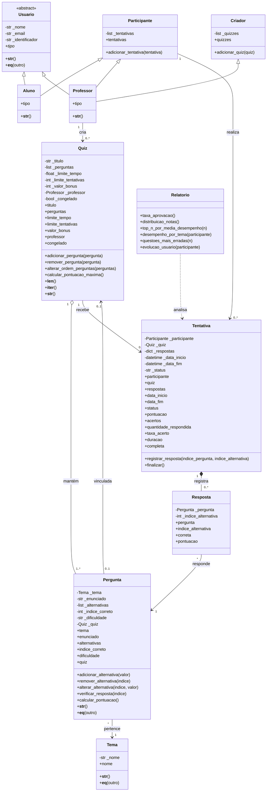

# Diagrama UML — Sistema de Quiz Educacional

Para retornar ao README, [clique aqui](../README.md).

## Observações sobre o modelo

- `Usuario` é uma classe abstrata.
- `Aluno` e `Professor` herdam de `Usuario`.
- `Participante` e `Criador` são classes independentes, reutilizadas por múltipla herança.
- `Professor` pode atuar como criador e participante.
- `Quiz` mantém uma coleção de perguntas.
- `Tentativa` registra as respostas de um participante em um quiz.
- `Relatorio` analisa os dados das tentativas.

